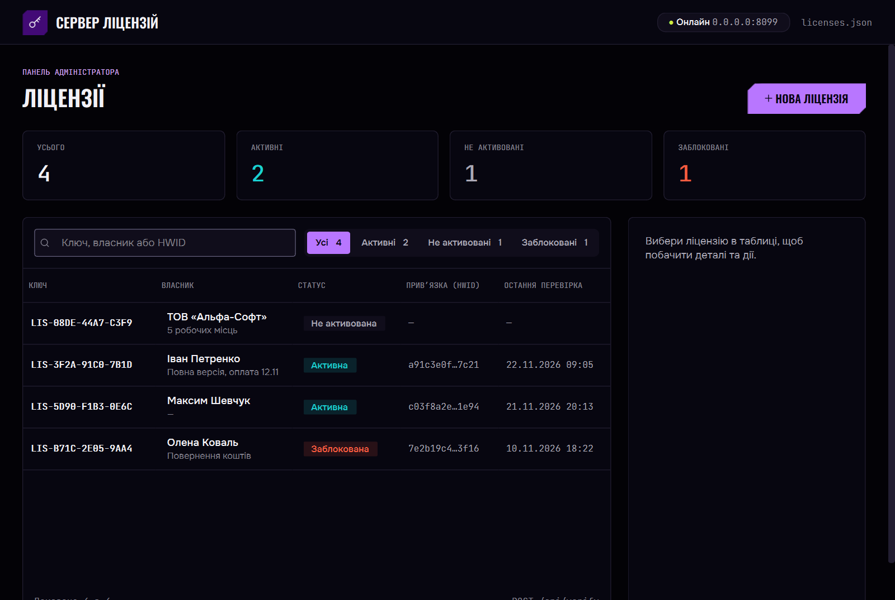

# LicenseServer

> Сервер ліцензій для Qt-програм з панеллю адміністратора.
> Навчальний MVP-проєкт, лабораторна робота 2.8 «Від ідеї до MVP».

## 1. Опис проєкту

LicenseServer — десктопний застосунок на C++17 і Qt 6, який захищає Qt-програми від копіювання. Адміністратор видає ключ, покупець вписує його в `license.json`, і при першому запуску програма прив'язується до його ПК. На іншому комп'ютері той самий ключ не спрацює.

### Ключові можливості

- **Видача ключів** формату `LIS-XXXX-XXXX-XXXX` з власником і приміткою, копіювання в один клік.
- **Прив'язка до ПК (HWID)** при першій перевірці ключа.
- **Керування ліцензіями**: блокування, скидання HWID, видалення.
- **Пошук і фільтри** за ключем, власником, HWID і статусом; лічильники статусів.
- **Захист відповіді**: сервер підписує її HMAC-SHA256 з `nonce`, тому підроблений «valid» не пройде.
- **Збереження даних** у `licenses.json` (`QJsonDocument`).
- **Клієнтський модуль**: захист вмикається одним викликом `requireLicense()`.

## 2. Скріншоти

Панель адміністратора: статистика, пошук, таблиця ліцензій.



Деталі вибраної ліцензії та дії над нею.


## 3. Інструкція зі збірки

**Вимоги:** компілятор з C++17, Qt 6 (Core, Gui, Widgets, Network), CMake ≥ 3.21.

```bash
git clone https://github.com/MoriNoAkuma/license-server.git
cd license-server

cmake -B build -DCMAKE_BUILD_TYPE=Release -DCMAKE_PREFIX_PATH=<шлях до Qt>/6.x/mingw_64
cmake --build build

./build/LicenseServer          # панель адміністратора, порт 8099
ctest --test-dir build         # автоматичні тести
```

Або в Qt Creator: **File → Open File or Project → `CMakeLists.txt`**.

## 4. Підключення захисту до своєї програми

1. Скопіювати `client/licenseclient.h` і `client/licenseclient.cpp` у проєкт і додати модуль `Qt6::Network`.
2. У `main()` після створення `QApplication`: `if (!requireLicense()) return 1;`
3. Біля exe покласти `license.json`:
   ```json
   { "key": "LIS-XXXX-XXXX-XXXX", "server": "http://127.0.0.1:8099" }
   ```

## 5. Документація

- [Пітч і аналіз аналогів](docs/1-discovery.md)
- [User Stories, wireframe, варіанти використання](docs/2-ux.md)
- [Доменна модель і SOLID](docs/3-domain.md)
- [UML-діаграма класів і патерни](docs/4-architecture.md)
- [Схема даних і протокол](docs/5-data.md)
