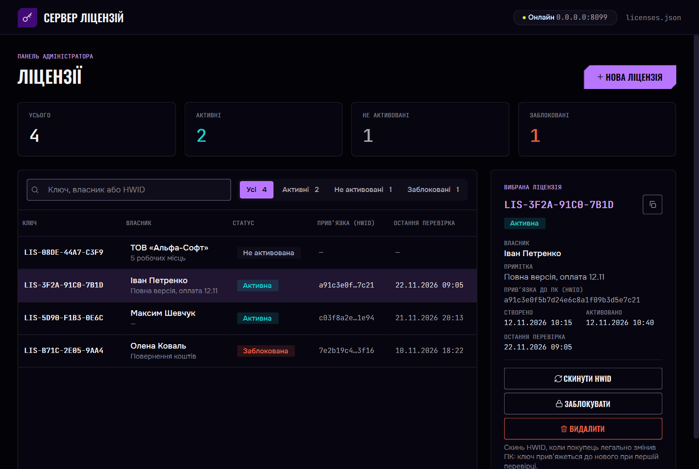

# Сервер ліцензій для Qt-програм

Лабораторна робота 2.8 «Від ідеї до MVP: створення власного застосунку на Qt».

Локальний сервер ліцензій з панеллю адміністратора і клієнтський модуль, який захищає будь-яку Qt-програму одним викликом. Адмін видає ключ, покупець вписує його в `license.json`, програма при першому запуску прив'язується до його ПК. На іншому ПК той самий ключ не спрацює. Ключ можна заблокувати або скинути прив'язку.

**Для кого:** студенти, фрилансери і невеликі студії, яким треба просте ліцензування без платних SaaS і без інтернету.

## Скриншоти

Головне вікно: статистика, пошук, фільтри, таблиця ліцензій.


Вибрана ліцензія: деталі й дії (скинути HWID, заблокувати, видалити).



## Можливості

- Видача ключів `LIS-XXXX-XXXX-XXXX` з власником і приміткою, копіювання в буфер.
- Прив'язка ключа до ПК (HWID) при першій перевірці.
- Блокування / розблокування, скидання HWID, видалення.
- Пошук за ключем, власником, HWID; фільтр за статусом; лічильники.
- Таблиця оновлюється сама, коли клієнт перевіряє ключ.
- Відповідь сервера підписана HMAC-SHA256 з `nonce`, тому підроблений «valid» не пройде.
- Дані — в `licenses.json` біля exe.

## Документація по етапах

| Етап | Документ |
|---|---|
| 1. Discovery: пітч, аналіз аналогів | [docs/1-discovery.md](docs/1-discovery.md) |
| 2. UX: user stories, wireframe, варіанти використання, діаграма | [docs/2-ux.md](docs/2-ux.md) |
| 3. Доменна модель, SOLID | [docs/3-domain.md](docs/3-domain.md) |
| 4. UML-діаграма класів, патерни, пам'ять | [docs/4-architecture.md](docs/4-architecture.md) |
| 5. Data Layer: схема JSON, протокол | [docs/5-data.md](docs/5-data.md) |
| 7. Bug Hunting | [нижче](#bug-hunting-cross-review) |

**Патерни коротко:** Repository (`LicenseStore`), Observer (сигнали/слоти Qt, `LicenseServer::changed → MainWindow::refresh`), Facade (`requireLicense()`), Dependency Injection (`LicenseStore&` у конструкторах), Static Factory Method (`License::fromJson`), Composite (дерево віджетів Qt).

## Структура

| Шлях | Що це |
|---|---|
| `server/license.*`, `licensestore.*`, `licenseserver.*` | Ядро `licensecore`: модель, сховище, HTTP-сервер (без GUI) |
| `server/mainwindow.*`, `licensedialog.*`, `main.cpp` | Панель адміністратора (Qt Widgets) |
| `server/style.qss`, `fonts/`, `icons/` | Оформлення (вбудовано через `resources.qrc`) |
| `client/` | `licenseclient.h/.cpp` — модуль для захищеної програми |
| `tests/tests.cpp` | Тести ядра і клієнта через справжній TCP |

## Збірка

Потрібні Qt 6 (Core, Gui, Widgets, Network), CMake ≥ 3.21, компілятор C++17.

**Qt Creator:** File → Open File or Project → `CMakeLists.txt` → Configure → Run.

**Командний рядок** (Windows, Qt у `D:\Qt` — підставте свій шлях):

```bash
cmake -S . -B build -G Ninja -DCMAKE_BUILD_TYPE=Release -DCMAKE_PREFIX_PATH=D:/Qt/6.12.0/mingw_64
cmake --build build
ctest --test-dir build --output-on-failure
```

Збирається `build/LicenseServer.exe` (панель адміна) і `build/tests.exe`. Щоб запустити exe поза Qt Creator, додайте `D:\Qt\6.12.0\mingw_64\bin` у `PATH` або виконайте `windeployqt build/LicenseServer.exe`.

Сервер слухає порт **8099**. При першому запуску Windows може запитати дозвіл брандмауера — він потрібен, якщо клієнти будуть з інших ПК.

## Підключення захисту до своєї програми

1. Скопіювати `client/licenseclient.h` і `client/licenseclient.cpp` у проєкт.
2. Додати їх і модуль `Network` у збірку.

   CMake:
   ```cmake
   find_package(Qt6 REQUIRED COMPONENTS Widgets Network)
   target_sources(MyApp PRIVATE licenseclient.cpp licenseclient.h)
   target_link_libraries(MyApp PRIVATE Qt6::Widgets Qt6::Network)
   ```
   qmake:
   ```
   QT += core gui widgets network
   SOURCES += licenseclient.cpp
   HEADERS += licenseclient.h
   ```
3. У `main.cpp` після створення `QApplication`:
   ```cpp
   #include "licenseclient.h"

   int main(int argc, char* argv[]){
       QApplication app(argc, argv);
       if (!requireLicense()) return 1;   // без дійсної ліцензії - вихід
       MainWindow w;
       w.show();
       return app.exec();
   }
   ```
4. Біля exe покласти `license.json` (якщо його немає, програма створить шаблон і покаже шлях):
   ```json
   { "key": "LIS-XXXX-XXXX-XXXX", "server": "http://127.0.0.1:8099" }
   ```
   Для іншого ПК у мережі — IP сервера, наприклад `http://192.168.0.105:8099`.

## Робота адміністратора

1. **Нова ліцензія** → ввести власника → **Створити ключ** → **Скопіювати** → надіслати покупцю.
2. Покупець змінив ПК → вибрати ліцензію → **Скинути HWID**.
3. Повернення коштів → **Заблокувати**. Діє з наступного запуску програми покупця.

## Обмеження

- Ліцензія перевіряється лише при запуску програми.
- Секрет HMAC (`SECRET` у `client/licenseclient.cpp` і `server/licenseserver.cpp`) вшитий у клієнт і має збігатися на обох сторонах. Захист навчальний: для реального продажу підпис варто робити асиметричним ключем (Ed25519).

## Bug Hunting (Cross-Review)

Напарник тестує збірку і створює Issues за шаблоном **Баг** (`.github/ISSUE_TEMPLATE/bug_report.md`: Steps to reproduce, Expected result, Actual result). Кожен баг закривається комітом з `Fixes #N` у повідомленні.

| Issue | Опис | Коміт-виправлення |
|---|---|---|
| #1 | _заповнити після review_ | |
| #2 | _заповнити після review_ | |

Скриншоти закритих Issues: [docs/issues/](docs/issues/).
