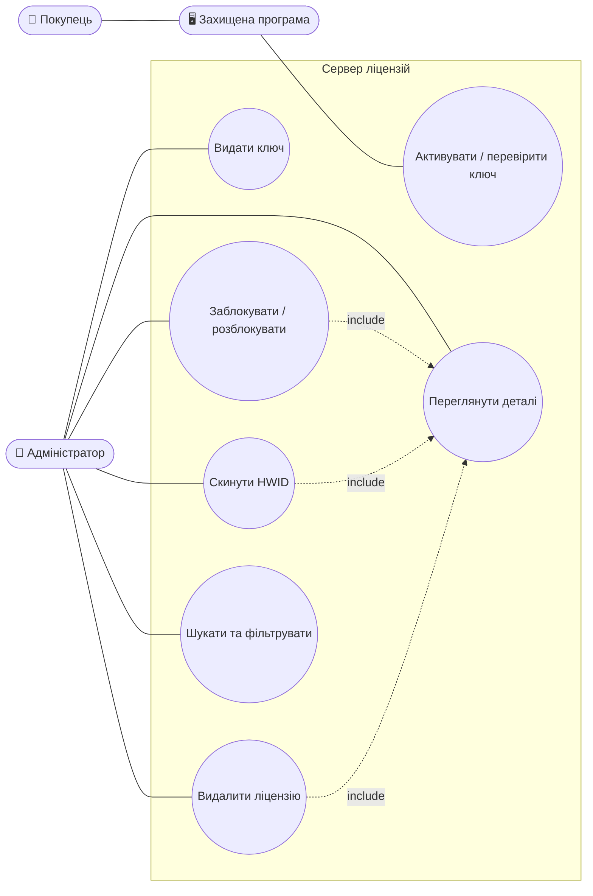

# Етап 2. UX, User Stories, варіанти використання

## Ролі

- **Адміністратор (продавець)** — працює з панеллю сервера: видає, блокує, скидає ключі.
- **Покупець** — запускає захищену програму з ключем.
- **Розробник** — вбудовує клієнтський модуль у свою програму.
- **Захищена програма** — системний актор, який шле запит `POST /api/verify`.

## User Stories

1. **Як адміністратор**, я хочу створити ключ, вказавши ім'я покупця і примітку, і одразу скопіювати його, **щоб** за хвилину надіслати ключ покупцю після оплати.
   *Критерії:* ключ має формат `LIS-XXXX-XXXX-XXXX`; він унікальний; після створення з'являється в таблиці зі статусом «Не активована»; кнопка копіює ключ у буфер.

2. **Як покупець**, я хочу вписати ключ у `license.json` і просто запустити програму, **щоб** вона активувалась на моєму ПК без реєстрацій і акаунтів.
   *Критерії:* перший запуск прив'язує ключ до HWID цього ПК; наступні запуски проходять; на іншому ПК той самий ключ отримує відмову «Ключ уже активовано на іншому комп'ютері».

3. **Як адміністратор**, я хочу заблокувати ключ після повернення коштів, **щоб** програма покупця перестала запускатися.
   *Критерії:* статус змінюється на «Заблокована»; при наступному старті клієнт показує «Ліцензія заблокована»; блокування можна зняти.

4. **Як адміністратор**, я хочу скинути прив'язку до ПК, **щоб** покупець, який легально змінив комп'ютер, міг активувати ключ знову.

5. **Як адміністратор**, я хочу шукати за ключем, ім'ям або HWID і фільтрувати за статусом, **щоб** швидко знайти потрібну ліцензію серед сотень.

6. **Як розробник**, я хочу підключити захист одним викликом `requireLicense()`, **щоб** не писати мережевий і криптографічний код самому.

## Wireframe

Чорновий макет головного вікна (до реалізації):

```
+--------------------------------------------------------------------------+
| [ключ] СЕРВЕР ЛІЦЕНЗІЙ                    (● Онлайн 0.0.0.0:8099) файл   |
+--------------------------------------------------------------------------+
| ПАНЕЛЬ АДМІНІСТРАТОРА                                                    |
| ЛІЦЕНЗІЇ                                               [+ НОВА ЛІЦЕНЗІЯ] |
|                                                                          |
| +-----------+ +-----------+ +---------------+ +--------------+           |
| | УСЬОГО  4 | | АКТИВНІ 2 | | НЕ АКТИВОВАНІ | | ЗАБЛОКОВАНІ  |           |
| +-----------+ +-----------+ +---------------+ +--------------+           |
|                                                                          |
| +------------------------------------------------+ +-------------------+ |
| | [Пошук: ключ, власник, HWID] [Усі|Акт|Не|Блок] | | ВИБРАНА ЛІЦЕНЗІЯ  | |
| |------------------------------------------------| | LIS-....-....  [⧉] | |
| | КЛЮЧ | ВЛАСНИК | СТАТУС | HWID | ОСТАННЯ ПЕРЕВ.| | [Активна]         | |
| | LIS..| Іван    | Активна| a91..| 22.11 09:05   | | Власник, примітка | |
| | LIS..| ТОВ ... | Не акт.|  —   |  —            | | HWID, дати        | |
| | ...                                            | | [Скинути HWID]    | |
| |                                                | | [Заблокувати]     | |
| | Показано 4 з 4               POST /api/verify  | | [Видалити]        | |
| +------------------------------------------------+ +-------------------+ |
+--------------------------------------------------------------------------+

Діалог «Нова ліцензія»:            Після створення:
+---------------------------+      +---------------------------+
| Власник: [____________]   |      | Ключ створено ✓           |
| Примітка: [___________]   |      | LIS-3F2A-91C0-7B1D        |
|           [___________]   |      | Власник: Іван             |
| [Скасувати] [Створити]    |      | [Скопіювати] [Ще одну]    |
+---------------------------+      +---------------------------+
```

Готовий інтерфейс — у [README](../README.md#скриншоти).

## Діаграма варіантів використання



## Детальні варіанти використання

### ВВ-1. Видача ключа

| | |
|---|---|
| **Актор** | Адміністратор |
| **Передумова** | Сервер запущено, `licenses.json` доступний для запису |
| **Основний потік** | 1. Адмін натискає «Нова ліцензія». 2. Система відкриває форму. 3. Адмін вводить власника і (необов'язково) примітку, натискає «Створити ключ». 4. Система генерує унікальний ключ `LIS-XXXX-XXXX-XXXX`, зберігає ліцензію у файл і показує ключ. 5. Адмін натискає «Скопіювати», потім «Готово». 6. Таблиця і лічильники оновлюються. |
| **Альтернативи** | 3а. Поле «Власник» порожнє — кнопка «Створити» неактивна. 5а. «Ще одну» — форма очищується для наступного ключа. 5б. «Готово» — діалог закривається, нова ліцензія виділена в таблиці. |
| **Результат** | Нова ліцензія зі статусом «Не активована». |

### ВВ-2. Активація і перевірка ключа при запуску програми

| | |
|---|---|
| **Актор** | Захищена програма (від імені покупця) |
| **Передумова** | У `license.json` біля exe вписано ключ і адресу сервера |
| **Основний потік** | 1. Програма викликає `requireLicense()`. 2. Клієнт рахує HWID і генерує випадковий `nonce`. 3. Шле `POST /api/verify {license_key, hardware_id, nonce}`. 4. Сервер знаходить ліцензію; якщо вона ще не активована — прив'язує до HWID. 5. Сервер оновлює «останню перевірку», зберігає файл, підписує відповідь HMAC-SHA256 і повертає `valid`. 6. Клієнт перевіряє підпис і `nonce`, програма відкриває головне вікно. 7. Таблиця в панелі адміна оновлюється (сигнал `changed`). |
| **Альтернативи** | 1а. Файлу немає — створюється шаблон, показується шлях, програма закривається. 4а. Ключа немає → `invalid`. 4б. Заблоковано → `blocked`. 4в. Інший HWID → `hwid_mismatch`. 3а. Сервер недоступний → «Сервер ліцензій недоступний». 6а. Підпис або `nonce` не збігаються → «не пройшла перевірку підпису». У всіх випадках показується причина і програма закривається. |
| **Результат** | Програма запущена лише на ПК, до якого прив'язано ключ. |

### ВВ-3. Блокування ліцензії

| | |
|---|---|
| **Актор** | Адміністратор |
| **Передумова** | Ліцензія існує |
| **Основний потік** | 1. Адмін шукає ліцензію (пошук або фільтр). 2. Вибирає рядок — справа з'являються деталі. 3. Натискає «Заблокувати». 4. Система ставить `blocked = true`, зберігає файл. 5. Статус у таблиці й деталях стає «Заблокована», кнопка змінюється на «Розблокувати». |
| **Альтернативи** | 4а. Файл не вдалося зберегти — повідомлення «Не вдалося зберегти licenses.json». 3а. Ліцензія вже заблокована — та сама кнопка розблоковує. |
| **Результат** | При наступному запуску клієнт отримає `blocked`. |
