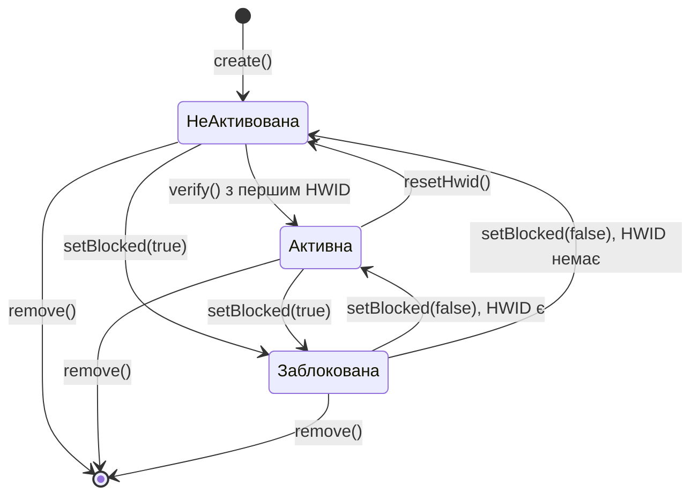

# Етап 3. Доменна модель

Бізнес-логіка зібрана в бібліотеку `licensecore` (див. [CMakeLists.txt](../CMakeLists.txt)). Вона залежить лише від `Qt6::Core` і `Qt6::Network` і не знає про вікна — панель адміна можна замінити на консоль чи веб, ядро лишиться тим самим. Це перевіряють тести: вони працюють з ядром без жодного вікна.

## Сутності предметної області

| # | Сутність | Що це | Як представлена в коді |
|---|---|---|---|
| 1 | **Ліцензія** | Право запускати програму: ключ, власник, стан, прив'язка, дати | клас `License` |
| 2 | **Покупець** | Хто купив ключ | поля `owner`, `note` у `License` (окремий клас для MVP зайвий: у покупця немає власної поведінки) |
| 3 | **Пристрій (HWID)** | ПК, до якого прив'язано ключ | рядок `hwid` у `License`; обчислює `LicenseClient::hardwareId()` |
| 4 | **Реєстр ліцензій** | Усі видані ключі та правила роботи з ними | клас `LicenseStore` |
| 5 | **Запит / результат перевірки** | Що питає клієнт і що відповідає сервер | JSON `{license_key, hardware_id, nonce}` → `{status, message, hwid, nonce, sig}` |

Життєвий цикл ліцензії:

## Класи та SOLID

### `License` — модель (Entity)
- Знає лише свій стан: `status()`, `isActivated()`, `activate(hwid)`, `resetHwid()`, `touch()`.
- Вміє перетворюватися в JSON і назад (`toJson` / `fromJson`) — це формат самої сутності, а не робота з файлами.
- Поля приватні, змінюються лише через методи — інваріант «дата активації є тоді й тільки тоді, коли є HWID» не зламати ззовні.

### `LicenseStore` — реєстр і правила (Repository + доменний сервіс)
- Тримає `QMap<ключ, License>`, генерує унікальні ключі, виконує операції адміна.
- `verify(key, hwid)` — єдине місце з правилами перевірки (invalid / blocked / прив'язка / hwid_mismatch).
- `load()` / `save()` — збереження в JSON; пошкоджений файл не перезаписується.

### `LicenseServer` — мережевий протокол
- Розбирає HTTP, викликає `store.verify()`, підписує відповідь HMAC-SHA256.
- Не містить бізнес-правил: що відповісти, вирішує `LicenseStore`.

### `LicenseClient` — клієнтська сторона
- Збирає HWID, шле запит, перевіряє підпис і `nonce`.
- `requireLicense()` — фасад для розробника: читає `license.json`, показує причину відмови.

### Як виконано принципи

| Принцип | Де видно |
|---|---|
| **S** — одна відповідальність | модель (`License`), правила і зберігання (`LicenseStore`), транспорт (`LicenseServer`), відображення (`MainWindow`, `LicenseDialog`) — окремі класи. Зміна формату HTTP не чіпає правил, зміна вигляду таблиці не чіпає ні того, ні іншого. |
| **O** — відкритість до розширення | новий статус відповіді додається в `verify()`, клієнт показує `message` з сервера без змін коду; новий інтерфейс (консоль, веб) підключається до того ж `LicenseStore`. |
| **L** — підстановка | `LicenseServer` успадковує `QTcpServer` і використовується як звичайний `QTcpServer` (`listen`, `close`, `serverPort` у тестах). |
| **I** — вузькі інтерфейси | вікну потрібні лише операції сховища; серверу — лише `verify()`; клієнт для розробника зведено до однієї функції `requireLicense()`. |
| **D** — залежність від переданого | `LicenseServer`, `MainWindow`, `LicenseDialog` отримують `LicenseStore&` у конструкторі, а не створюють його самі. Тому в тестах сервер працює з тимчасовим файлом. |

**Чесне обмеження MVP:** `LicenseStore` поєднує правила і запис у файл. Якщо з'явиться SQLite, `load/save` варто винести в окремий клас-інтерфейс `ILicenseRepository` з реалізаціями `JsonRepository` і `SqliteRepository`.
