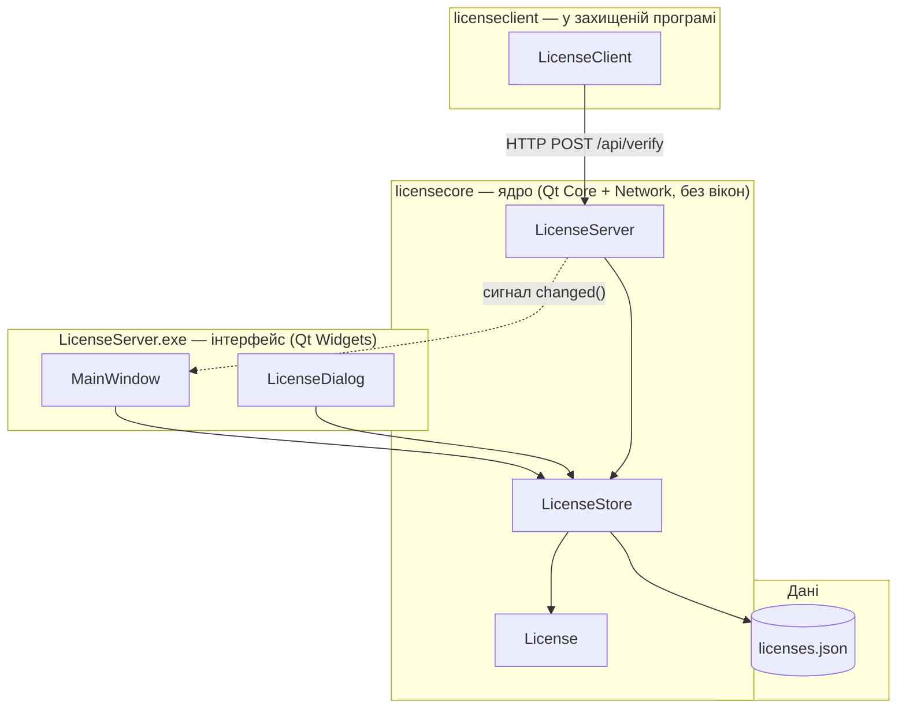
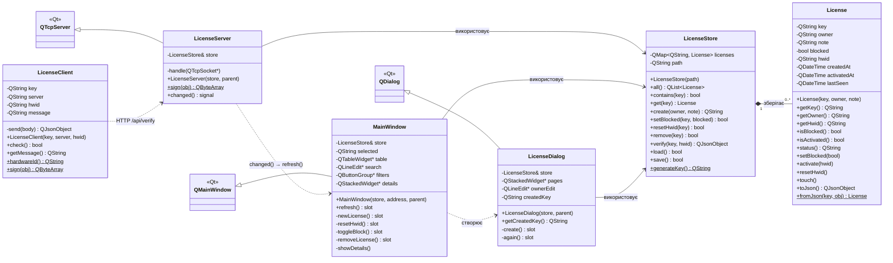

# Етап 4. Архітектура та патерни

## Шари

## UML-діаграма класів

## Використані патерни проєктування

| Патерн | Де | Навіщо |
|---|---|---|
| **Repository** | `LicenseStore` | Вікно і сервер працюють з колекцією ліцензій через методи `create / get / remove / verify`, не знаючи, що всередині JSON-файл. Заміна на SQLite не зачепить GUI. |
| **Observer** (сигнали і слоти Qt) | `LicenseServer::changed` → `MainWindow::refresh`; `textChanged`, `idClicked`, `itemSelectionChanged` | Сервер не знає про вікно, але таблиця оновлюється, щойно клієнт активувався. |
| **Facade** | `requireLicense()` | Ховає HWID, HTTP, HMAC, nonce і діалоги помилок за одним викликом. Розробнику захищеної програми треба один рядок. |
| **Dependency Injection** (через конструктор) | `LicenseStore&` передається в `LicenseServer`, `MainWindow`, `LicenseDialog` | Один екземпляр сховища на всю програму; у тестах підставляється сховище з тимчасовим файлом. |
| **Static Factory Method** | `License::fromJson`, `LicenseStore::generateKey` | Створення ліцензії з JSON і генерація ключа в одному місці, з правилами формату. |
| **Composite** (дерево об'єктів Qt) | віджети вікна | Вікно — дерево віджетів; батько малює і видаляє всіх дітей. |

## Управління пам'яттю

- **Дерево об'єктів Qt.** Віджети створюються через `new` і одразу кладуться в layout, який робить їх дітьми вікна. Коли вікно знищується, Qt видаляє всіх нащадків — ручних `delete` у коді немає.
- **Тимчасові об'єкти мережі.** Кожен `QTcpSocket` видаляється через `deleteLater` по сигналу `disconnected`; `QNetworkReply` — через `deleteLater` після прочитання.
- **Стек для довгоживучих об'єктів.** `LicenseStore`, `LicenseServer`, `MainWindow` живуть на стеку `main()` у правильному порядку: сховище створюється першим і знищується останнім, тому посилання `LicenseStore&` в інших класах ніколи не «висить».
- **Модальний діалог** `LicenseDialog` створюється на стеку `MainWindow::newLicense()` і зникає після `exec()`.
- **Значення замість вказівників.** `License` — звичайний копійований клас у `QMap`, тому витоків тут бути не може.
